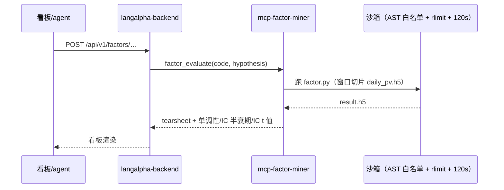
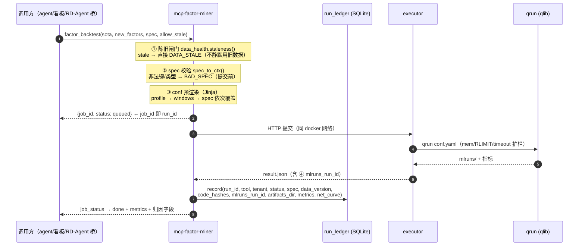
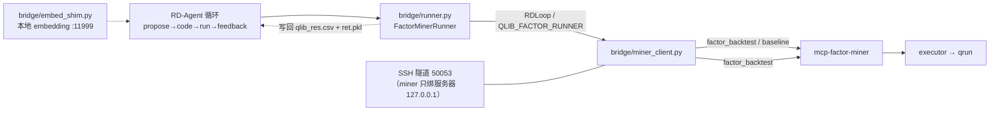

# 架构（当前状态 · 2026-09-25）

> 本文是**当前**架构的权威描述，取代此前的 `system-architecture.md`（那版是 09-23 的快照）与
> `architecture-quant-link-audit.md`（那版侧重依赖与结果去向审计，结论仍然有效）。
> 所有组件、端口、工具数、字段均来自实测。

---

## 1. 全景（分层）

```
                        人（LangAlpha 看板）     agent（athena / 微信 / CI）    RD-Agent（研究侧）
                                │                        │                          │
                                │ REST /api/v1/factors   │ MCP tools/call           │ bridge/runner.py
                                ▼                        ▼                          ▼
   ┌───────────────────────────────────────────────────────────────────────────────────────────┐
   │ 入口：nginx (host, systemd)                                                                │
   │   langalpha.causal-memory.com / athena.* → :8000    causal-memory.com/hub → :3200          │
   │   /quota → :3300   /causal → :50057   /global → :50058   /wb → :50062 (mcp·tools 403)      │
   └───────────────────────────────────────────────────────────────────────────────────────────┘
                                │
   ┌────────────────────────────▼──────────────────────────────────────────────────────────────┐
   │ 平台层  project=langalpha        network: langalpha_default                                │
   │   langalpha-backend-1 (FastAPI :8000, mem 5120m)  ·  postgres(3.2G 卷)  ·  redis            │
   │   双归属网络 → 可直接用 http://mcp-factor-miner:50053（实测 /health=200）                    │
   └────────────────────────────┬──────────────────────────────────────────────────────────────┘
                                │
   ┌────────────────────────────▼──────────────────────────────────────────────────────────────┐
   │ MCP 域层  project=mcp-suite      network: mcp-suite_default                                │
   │                                                                                            │
   │   ┌── mcp-factor-miner :50053 (mem 1536m) ── 工具面 21 ────────────────────────────────┐   │
   │   │  L1 数据与运行  data_status · run_get · run_list · update_data · job_status        │   │
   │   │  L2 原子能力    factor_backtest(spec) · factor_evaluate · factor_recent_ic ·       │   │
   │   │                 factor_tearsheet · factor_execute · ml_train_rolling · ml_predict  │   │
   │   │                 ml_metrics · portfolio_optimize · regime_detect · change_point ·   │   │
   │   │                 vol_forecast · compute_factors · predict                          │   │
   │   │  L3 元能力      capabilities（自描述：契约/字段/引擎/台账）                          │   │
   │   │  横切：X-License-Key 鉴权 · 异步 job 队列(per-license 单槽) · AST 白名单沙箱          │   │
   │   │        run_ledger(SQLite) · data_health(陈旧闸门)                                   │   │
   │   └───────────────┬───────────────────────────────────────────────────────────────────┘   │
   │                   │ HTTP（**同网络**，不走宿主端口）                                        │
   │   ┌───────────────▼── mcp-factor-executor :50054（未发布到宿主）──┐                        │
   │   │  qrun <conf.yaml>  · qlib 0.9.7 · mlflow 3.16.1              │                        │
   │   │  护栏：mem_limit 4600m · RLIMIT_AS 7168MiB · timeout 1800s    │                        │
   │   │  产物：mlruns/ · result.json（含 mlruns_run_id）· qrun.log     │                        │
   │   └───────────────────────────┬──────────────────────────────────┘                        │
   │   astock-data :50052 · causal :50057 · global-data :50058 · kronos :50059                 │
   │   workbench :50062 · causal-memory :50061 · redis                                          │
   └────────────────────────────┬──────────────────────────────────────────────────────────────┘
                                │
   ┌────────────────────────────▼──────────────────────────────────────────────────────────────┐
   │ 控制面（network: host）  mcphub :3100（已注册 10 个 server）· quota-platform :3200/:3300    │
   │ 宿主机 systemd           cm-tenant-shim :51061（causal-memory 租户透传）                    │
   └────────────────────────────┬──────────────────────────────────────────────────────────────┘
                                │
   ┌────────────────────────────▼──────────────────────────────────────────────────────────────┐
   │ 数据与台账                                                                                 │
   │  /opt/athena-mcp/qlib_data          846M  qlib .bin（6152 标的，日历→2026-09-24）           │
   │  /opt/athena-mcp/data/factor_mining 1.3G  面板 h5（**2026-09-15** ← 目前陈旧 10 天）        │
   │  /opt/mcp-suite/backtests           5.7M  run 产物（**TTL 24h**，7 个 run 目录存活）        │
   │  /opt/mcp-suite/usage/factor-miner        ★ quant_runs.db（run 台账，**不受 TTL 影响**）    │
   │  langalpha-postgresql-data          3.2G  factor_library（因子资产，metrics JSONB）        │
   │  ~/project/athena/athena.db         400M  mining_runs/mining_events（schema 在，0 行）      │
   └───────────────────────────────────────────────────────────────────────────────────────────┘
```

---

## 2. 链路 A：轻评估（不上 qrun，秒级）



## 3. 链路 B：重回测（当前最完整的一条，含本轮新增的四件事）



**本轮新增的四件事都在图里**：① `data_status`/陈旧闸门（G7）② `spec`（类型化 BacktestSpec，G1）
③ `run_ledger`（G3/G6）④ `mlruns_run_id`（按 run 归因）。

## 4. 链路 C：RD-Agent 桥（研究侧 → 我们的执行层）


实测：完整一轮 `direct_exp_gen→coding→running→feedback→record` 5/5 步 7m30s，$0.0148；
baseline 与因子轮两次回测都走 miner（76s / 324s）。

---

## 5. 工具面分层（21 个，给 agent 的契约）

> 计数口径：`tools=21`（启动日志实测）。网关在启用异步队列时**再追加 `job_status`**，
> 因此 `tools/list` 看到的是 22 —— 这个差异是刻意的（它是队列的元工具，不属于能力面）。

| 层 | 工具 | 治的缺口 |
|---|---|---|
| L1 数据与运行 | `data_status`、`run_get`、`run_list`、`update_data`、`job_status` | G7、G6 |
| L2 原子能力 | `factor_backtest`(spec)、`factor_evaluate`、`factor_recent_ic`、`factor_tearsheet`、`factor_execute`、`ml_train_rolling`、`ml_predict`、`ml_metrics`、`portfolio_optimize`、`regime_detect`、`change_point`、`vol_forecast`、`compute_factors`、`predict` | G1 |
| L3 元能力 | `capabilities`（引擎/字段/契约/台账自描述） | G2、G8 |
| 横切 | `X-License-Key`、异步 job 队列、`error_code`+`retryable` | G4、G5(部分) |

**错误码**：`BAD_SPEC` / `DATA_STALE` / `DEDUP_DROPPED` / `FACTOR_CODE_FAILED` / `ENGINE_MEMORY` / `TIMEOUT` / `DATA_MISSING` / `ENGINE_ERROR`，
每条带 `retryable` 与 `hint` —— agent 可据此自愈。

---

## 6. 当前状态与已知问题（诚实区）

| # | 事项 | 现状 |
|---|---|---|
| 1 | **面板陈旧 10 天** | 面板 h5 = 2026-09-15，.bin 日历 = 2026-09-24 → 闸门已生效，**所有回测返回 `DATA_STALE`**（含 RD-Agent 桥）。修法：重跑 `gen_data` 重建 h5（2-5 分钟），并查 `update_data` 为何"抓数成功但 h5 不跟" |
| 2 | **部署方式** | miner/executor 的改动目前是 `docker cp` + 重启落地的（代码烧在镜像里）。**持久化必须 `docker compose build factor-miner factor-executor`**；在此之前**绝不要 `up -d` 重建这两个容器**，否则改动全丢 |
| 3 | SigAna 三指标重复之谜 | 已排除"取最新 recorder 挑错"（该 experiment 仅 1 个 run，run id 各自不同）；已定位到 recorder 的 `metrics` 文件，但其聚合文件里 grep 不到 IC 键 → 下一步 `ls <run>/metrics/`（mlflow 是**一键一文件**）定案 |
| 4 | 产物保留期 | 大文件仍 TTL 24h（台账不受影响，指标与归因已常驻） |
| 5 | G5 并发 | 只有 `job_status`，缺 `job_list`/`job_cancel`；"槽位被永久占住"这个旧判断**存疑**（超时会把 job 置 error，槽位应当已释放），需先复现再修 |
| 6 | G9 人看的报告 | 只有 JSON/capabilities，尚无 `report: html` + CLI 门面 |
| 7 | athena 大脑 | 引擎未运行；`mining_runs`/`mining_events` 0 行（读面在跑，写面未启用） |

---

## 7. 与 09-23 版的主要差异（本轮新增）

1. miner 工具 **18 → 21**（`run_get`/`run_list`/`capabilities`/`data_status`，其中 baseline 复用 factor_backtest）
2. 新增 **run_ledger**（SQLite，`/app/usage/quant_runs.db`，独立于产物 TTL）+ 任务终态挂钩
3. 新增 **BacktestSpec**（universe/window/cost/strategy/model/seed）+ 两个 conf 模板的占位符（默认值不变）
4. 新增 **陈旧闸门**（`data_health`）+ `data_status` 工具
5. 新增 **错误码/retryable/hint**（`_classify_error`）
6. 执行器新增 **`mlruns_run_id` 回传**（parse 5 元组 → result.json → 台账）
7. RD-Agent 桥与 baseline 打通（详见 `rdagent-integration-runbook.md`）
