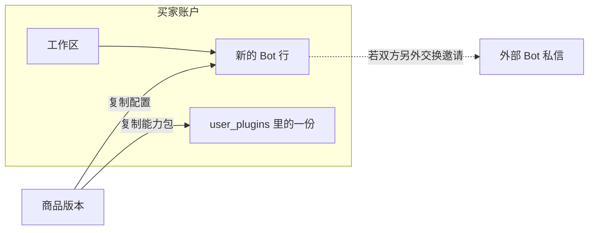
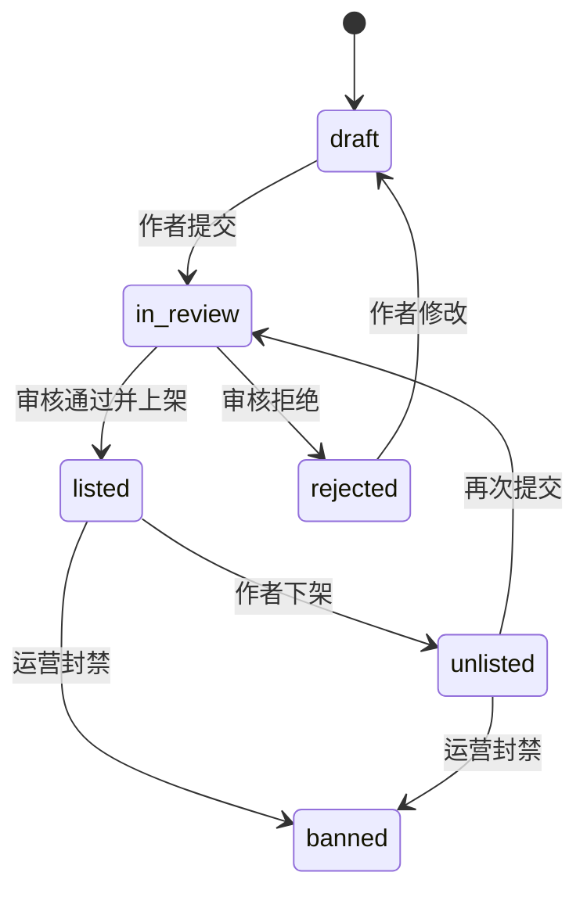

# dsalpha 商城：Bot 模板与插件

> 状态：设计稿，未实现。对照的代码是默认分支 `main`（撰写时 `c62ed55`）。
> 本文只指导后续开发。它不部署商城，不接真实支付，也不改现有业务代码。
> **第一版只做免费商城**：所有商品价格恒为 0，领取和安装不涉及积分、订单、抽成、退款和作者收益。
> 平台抽成 **8%**、作者 **92%** 是第二版（付费）的已定比例；第 5 节整节属于第二版，v1 不实现。

## 0. 先看这几条

**假设。** 「设置下载安装」是指：在商品页选择领取（v1 只有免费），然后安装。Bot 装进用户自己的某个工作区；插件装进用户自己的账户。不是再做一个「设置项市场」，也不是操作系统下载器。

**第一版（免费）已定。**

- 平台可以上架内置 Bot，用户一键安装后，在自己的工作区里得到一个新 Bot。
- 用户可以把自己做好的 Bot 收成模板发布（免费）。
- 插件同样可以上架（免费）。
- 免费商品不做购买授权：登录用户可以直接领取和安装，安装记录就是「我领过什么」的凭证。
- 用户上传的插件和 Bot 模板，公开上架前要经过人工审核。官方内置可以走精选通道。

**第二版（付费）方向，v1 不做。**

- 作者可以给自己的模板或插件标积分价，价格可以是 0（免费）。
- 付费成交时平台留 8%，作者留 92%。
- 商城只记整数积分。8% 用向下取整，作者拿剩余，两边之和等于标价。
- 付费商品设最低标价，避免把一笔大单拆成很多 8% 取整为 0 的小单。
- 授权按 dsalpha 的 `user_id`。同一商品买一次，之后在本账号里重复安装不再扣费。
- 赠送积分、套餐赠送积分不能买付费商品，也不能变成作者可结算收益。
- 第二版不做自动提现到现金。创作者收益先记在待结算账上。

**明确不做。**

- 不把 Bot 做成可共享的运行实例。安装得到的是一份新配置，跑在买家自己的工作区和电脑上。
- 不把跨账户的外部 Bot 私信当成商城。那是两个已经存在的 Bot 之间的邀请消息，见第 2 节。
- 不在商品里捆售 API key、别人的会话、记忆或私有文件。
- 不把 `skills`、`memory_scopes`、`approval` 当成已经生效的权限。它们今天只是存下来的字段。
- 不在这份设计里规定现金和积分的兑换率，也不规定税务处理。
- v1 不做：积分定价、订单、扣款、授权表、8% 分录、退款、提现、作者收益。

## 1. 仓库里已经有的，和必须新做的

下面每条都对得上现有文件。标「新增」的能力今天没有表、没有接口，不要到这些路径里找现成实现。

### 1.1 谁拥有什么

dsalpha 里的所有权是 **用户 → 电脑 → 工作区 → 对话**。

- 用户行在 `users`（`migrations/versions/001_initial_schema.py`）。主键是 `user_id`。没有组织表，没有工作区成员表，也没有「企业里谁能花谁的钱」的关系。`users.membership_id` 有这一列，但 `src/` 里没有读取它，不能当成商城角色。
- 工作区属于一个用户。Bot 属于一个工作区（`migrations/versions/112_bots_rooms.py`）。一个工作区最多 20 个 Bot（`src/server/database/bots.py` 的 `MAX_BOTS_PER_WORKSPACE`）。Home 里只有派生的 Chief of Staff，不能再手工创建一个 Bot（`src/server/app/bots.py`）。
- 登录分两种。`HOST_MODE=oss` 是单机本地用户，额度门禁直接放开。`HOST_MODE=platform` 且配置了 `AUTH_SERVICE_URL` 时，对话前会问额度服务（`src/server/dependencies/usage_limits.py` 的 `platform_gating_active`）。
- 托管计费文档 `docs/roost-billing.md` 写的是：把 Supabase 的 `user_id` 映射到 Roost 的一个组织钱包。那次映射在 Roost，不在本仓库的表里。自托管额度在 `quota-service`，钱包键也是 `user_id`（`quota-service/quota_service/schema.sql` 的 `billing.wallets`）。

所以本仓库没有「企业共享一份商城授权」的主体。第一版免费商品不产生授权，登录用户直接领取；第二版付费授权只发给付钱的那个 `user_id`。

### 1.2 Bot：身份，不是模板

今天的 Bot 是工作区里的一个身份：名字、人设、可选模型、工具黑白名单、技能名、记忆范围、审批级别、头像。创建入口是 `POST /api/v1/bots` 和主 Agent 的 `create_bot`。

真正会限制工具的，只有 `tools_allow` / `tools_deny`。构建主 Agent 时 `narrow_tools`（`src/tools/bots/scope.py`）按名字过滤：允许列表为空表示全部保留，拒绝列表优先。`create_bot` 的说明写明 `skills` 先存着，审批级别先存着，当前版本不会按它们自动批准，也不会按技能名限制能加载的技能。记忆范围同样只展示、不执行。

没有「Bot 模板」表，没有上架，没有从别人的 Bot 复制出一份干净配置的接口。

### 1.3 外部 Bot 不是商品

`src/server/app/guest_dm.py` 和 `docs/guest-bot-dm.md` 做的是：一个账户为自己的某个 Bot 发邀请，另一个账户的 Bot 凭邀请发来第一条消息，接收方接受之后两边才能继续对话。令牌只存哈希。双方不共享工作区、文件和电脑。

商城安装不得调用这套邀请，也不得把买家的 Bot 登记成卖家的联系人。装完之后如果两个人想让 Bot 互发消息，仍要走现有的邀请，和装没装模板无关。

### 1.4 插件：两种，商城只卖其中一种

| | 是什么 | 存在哪里 |
|---|---|---|
| Agent 插件 | 能力包：`plugin.json`、`mcp.json`、技能目录。安装后变成这个用户的 MCP 服务和技能 | `user_plugins`（`migrations/versions/028_agent_plugins.py`）。每用户每名字一份，最多 50 个（`src/server/database/plugins.py`） |
| 页面插件 | 应用里自带的页面开关 | `user_page_plugins`（`migrations/versions/114_user_page_plugins.py`）。只有启用位 |

商城卖的是 Agent 插件。页面插件不进入商品表。

已经有一个只读目录：`GET /api/v1/marketplace`（`src/server/app/marketplace.py`）。它读部署配置的 `PLUGIN_MARKETPLACE_URL`，列出可安装条目。没配这个变量时，发现页是关的（`src/config/env.py`）。安装仍走现有的 `POST /api/v1/plugins`，更新走 `POST /api/v1/plugins/{name}/update`。目录项可以带许可、发布者、OAuth 或 API key 的声明，以及要用户自己填写的密钥名（`src/server/models/marketplace.py`）。密钥写入该用户自己的保险库，不进插件包。

拉取远程包时按 URL 固定到来源，包体有大小上限（`src/server/services/plugins/fetch.py`）。第三方 stdio 服务要求用钉死版本的 `uvx` / `npx` 启动，不能进共享环境。这些检查今天服务于「这个用户自己安装了一个包」，没有付款、没有作者抽成、没有举报和封禁。

官方内置包在 `plugins/`，随镜像发布，不占 50 个名额，不能卸载（`plugins/README.md`）。一键安装官方 Bot 是新流程；一键安装官方插件可以复用现在的安装路径，但商品、版本记录（以及第二版的授权）是新的。

### 1.5 积分：只有用量钱包，没有作者钱包

两套额度，都只服务「这次运行花了多少」：

- 托管：Roost 组织钱包。对话用租约预占、结束时按 `spent_credits` 结算（`docs/roost-billing.md`，客户端在 `src/server/services/credit_gate_port.py`）。
- 自托管：`quota-service` 的 `billing.wallets.balance` 是 `numeric(20,6)`，流水 `billing.ledger` 用 `(source, source_id)` 做幂等（`quota-service/quota_service/credits.py` 的 `add_credits`）。Python 侧传入的是 `float`。管理端可以充值、发当月套餐积分。设计文档写明不做在线支付和退款。
- dsalpha 自己的 `src/server/database/runs/credit_ledger.py` 记的是一轮运行过程中还没结算的用量，不是用户余额，更不是作者收入。

`docs/roost-billing.md` 里的 `USD_TO_CREDITS_RATE=720`（注释写 100 积分约等于 1 元人民币）是用量换算的部署参数。代码里的默认值其实是 **1000**（`src/config/env.py`），文档里的 720 只是部署示例。它不是创作者把收益换成现金的汇率。商城设计不采用它，也不新定一个汇率。

今天没有：商品订单、买家对卖家的转账、待结算余额、退款冲销、提现。购买不能塞进运行租约，否则一笔商品会变成一轮对话的用量。**第一版（免费）完全不需要这些**；它们属于第二版。

### 1.6 对照

| 能力 | 现在 | 商城要新增 |
|---|---|---|
| 用户、工作区 | 有，一用户拥有 | 不改所有权 |
| 企业成员 | 无 | v1 不做共享授权 |
| Bot 行 | 有，工作区内身份 | 模板快照、上架、安装出新行（v1） |
| 外部 Bot 私信 | 有 | 保持独立，不复用 |
| 插件安装 | 有，每用户一份 | 商品版本在外面，安装仍落到 `user_plugins`（v1） |
| 发现目录 | 有，运营配置的只读列表 | 保留。商城列表是另一套接口，见第 8 节（v1） |
| 用量积分 | 有，外部钱包 | **v2**：新增「按订单号扣一次」的接口，额度服务今天没有 |
| 作者收益 | 无 | **v2**：新增，和用量余额分开 |
| 审核、举报、封禁 | 无 | 新增（v1） |

## 2. 三种东西不要叫混



**Bot 模板**是一份可复制的配置：名字建议、人设、头像、模型提示、工具允许和拒绝名单、声明依赖的插件、作者写的说明。安装在买家选定的工作区里 `POST /api/v1/bots` 出一行新的 `bots`。这行的 `user_id` 和 `workspace_id` 都是买家的。它不指向卖家的线程，不读卖家的记忆、文件、保险库。卖家后来改自己的 Bot，不会改到已经装出去的副本。

**外部 Bot**是两个活着的 Bot 跨账户说话。商品页不提供「加为好友」。安装成功页可以链到现有的 `/rooms?guest=1`，并写明那是另一件事。

**插件**是能力包。安装后买家要用自己的 OAuth 或自己的密钥。包内出现密钥、令牌、会话导出、记忆导出，审核直接拒绝。插件启用后按今天的实现影响该用户的各个工作区，这和 Bot「每个工作区一份副本」不同，商品页要写清楚。

官方精选是商品上的一个标记，不是另一种所有权。官方 Bot 模板的作者可以是平台账号。官方插件若已在 `plugins/` 里，安装记录记「内置包 + 版本」，不占 50 个用户插件名额；若官方另发一个需要用户密钥的连接器，则走普通 `user_plugins` 安装。

## 3. 从看见到安装，从发布到下架

### 3.1 发现和详情

一个商城，两个分区：Bot、插件。列表只出 `listed` 的版本。v1 只有免费商品，筛选只留官方精选、分类、最近更新；v2 再加「免费 / 付费」筛选。搜索只搜名称、简介和作者公开名，不搜人设全文和包内容。

详情页展示：作者、版本、更新说明、许可文本、Bot 的工具名单和依赖插件、插件要申请的密钥或 OAuth、这个版本的内容哈希。v1 的价格位固定显示「免费」；v2 才显示积分价。不展示卖家的对话和文件。

官方精选由运营标记。它不跳过恶意版本的禁用，只是排序靠前、并允许官方免费包不经用户投稿审核。

### 3.2 安装

**v1 只有免费商品，安装不涉及报价和扣款。**

Bot：

1. 买家选择自己的一个非 Home 工作区。该工作区未满 20 个，且名字不冲突；冲突时安装器在名字后加短后缀，仍冲突则让买家改名。
2. 直接安装。模板声明依赖的插件如果还没装，安装页列出并一并免费安装。
3. 安装写入新的 `bots` 行。`tools_allow` / `tools_deny` 照模板写入，因此之后的回合会走现有的 `narrow_tools`。技能名、记忆范围、审批级别也写入，但界面注明它们目前不会限制技能加载，也不会自动批准。
4. 写一条 `market_installs`：商品、版本、目标（工作区 + 新 `bot_id`）。这是 v1 的「我领过什么」凭证。

插件：

1. 若该用户已有同名 `user_plugins`，不第二次安装。名字被别的包占用则拒绝，并说明要先卸掉同名插件。
2. 包体来自商城保存的那个版本，不从作者事后改过的仓库重新拉。
3. 安装时弹出的密钥和 OAuth 仍是买家自己的。v1 免费安装，取消授权不涉及退款。

**v1 不写授权、不写订单。** 免费商品被下架不影响已装副本；被标恶意时按第 7 节处理。

**第二版（付费）才需要：** 未购买先展示报价（含尚未拥有的依赖），确认后扣款并写授权，再安装；同一 `(buyer user_id, listing id)` 只授权一次，重复安装不再扣费；插件每用户一份；免费商品也写 0 元订单和授权，钉死版本。详见第 5 节。

v1 和 v2 都一样：运行模型、沙箱和第三方数据的费用不包含在商品里，之后仍走现有用量门禁。模板里的模型名只是建议；买家账户选不了这个模型时，安装改为「跟随对话模型」，不影响商品本身（v1 也不涉及扣费）。

### 3.3 我的资产

v1 买家看到：我安装过的商品、装到了哪个工作区或哪个插件名、当前版本、有没有作者发布的新版本可更新。v2 再加上已获得的付费授权和「要另付费的升级」。

v1 作者看到：自己发布的商品、各版本状态。v2 再加销量、待结算和可结算积分（可结算在第二版也只是记账，不能自动打到银行卡）。

### 3.4 发布

Bot：从自己某个工作区里的一个 Bot 生成模板。生成时只复制第 6 节允许的字段，并丢掉秘密。作者补简介、分类、许可、依赖插件。v1 没有价格字段（固定免费）；v2 再加积分价。

插件：上传符合现有 Agent Plugins 格式的包，或给出已固定提交的公开 git 地址。商城把通过检查的字节存下来，之后买家装的是这份字节，不是仓库的浮动分支。

v1 价格恒为 0。第二版的价格是非负整数，0 表示免费，付费最低标价见第 5 节；发布接口届时再加 `price`。

### 3.5 审核、上下架、举报、封禁

用户投稿先到 `in_review`。审核人是部署方配置的运营 `user_id` 列表（新增，不读 `membership_id`）。通过后作者才能上架。官方精选可以由运营直接标 `listed`。

作者可以下架。下架停止新领取（v2 是停止新购买），已领取/已购买的人仍可安装已拿到的版本，除非该版本被标成恶意。

举报由登录用户提交，指向一个版本。运营可以：驳回、下架整个商品、禁用某一个版本、暂停作者再发布。封禁作者不删除买家已经装上的副本，但会禁止继续安装被禁用的版本，并向已安装的人展示「这一版已被停用」。

审核记录和处置都进审计日志。第一版不做自动机审模型，只做秘密扫描和清单检查；过不了扫描的不能进人工队列。

## 4. 商品模型

一类商品，Bot 和插件用类型字段区分。**v1 只有免费商品，所以 v1 只落这四张表：**

```text
market_listings            商品（稳定 id，作者，类型，状态）
market_versions            一个不可变版本（字节或配置快照，哈希，依赖）
market_installs            一次安装实例
market_audit               审核、举报、封禁、下架的动作记录
```

**第二版（付费）再加：**

```text
market_prices              这个版本的价格（正整数；v2 的免费商品也可写 0）
market_orders              一笔订单
market_entitlements        买家对一个商品的授权
market_ledger_entries      作者侧和平台侧的积分分录（见第 5 节）
```

v1 不写价格、订单、授权和分录；安装成功即代表可以使用。买家花掉的用量积分不写在这些表里；v2 的扣款发生在额度服务，订单只保存额度服务返回的回执号。

### 4.1 共有字段

商品：`listing_id`，`kind`（`bot_template` | `plugin`），`owner_user_id`，`slug`，`title`，`summary`，`status`，`featured`，`created_at`。v1 没有 `price` 字段。

版本：`version_id`，`listing_id`，`version_label`，`content_hash`，`changelog`，`update_class`（`fix` | `upgrade`），`status`，`created_at`。版本行发布后不改字节；v2 发布后也不改价格，要改就新版本。

安装（v1）：`install_id`，`listing_id`，`version_id`，`buyer_user_id`，`target`（Bot 是 `workspace_id` + 新 `bot_id`；插件是 `user_plugin_id` 或内置包名），`status`，`created_at`。v2 再加 `entitlement_id`。

**v2 专有字段：** 价格（`version_id` 主键，`amount` 整数，`currency` 固定 `credits`）；订单（`order_id`，`buyer_user_id`，`idempotency_key`，`status`，`quote_total`，`lines`，`debit_receipt`）；授权（`buyer_user_id`，`listing_id`，`version_id`，`source_order_id`，`status`）。

### 4.2 Bot 专有

版本快照 JSON，只允许这些键：`template_schema_version`，`name`，`persona`，`avatar`，`model`（可空），`tools_allow`，`tools_deny`，`skills`（仅名字），`memory_scopes`，`approval`，`required_plugins`（商品 id + 最低版本）。`template_schema_version` 是这个配置结构自己的版本，和 `version_label` 无关：字段以后增删时，已安装的副本要靠它决定怎么迁移。

禁止出现：`bot_id`，`workspace_id`，`user_id`，`primary_thread_id`，任何文件路径内容，记忆正文，保险库，邀请令牌。

发布校验：`tools_allow` 必须是非空的明确名单。空名单在现运行时意味着「全部工具」，商城不允许这样上架。`tools_deny` 可空。`persona` 最长仍是创建接口的 20,000 字符。

### 4.3 插件专有

版本保存：包字节的对象存储键、`content_hash`、来源 URL 与固定修订、`plugin.json` / `mcp.json` 的清单副本、声明的密钥名和 OAuth 需求、依赖的其他插件商品。

不保存密钥的值。买家安装时才用现有的保险库写入。

### 4.4 依赖和报价

Bot 可以依赖插件。插件可以依赖插件。谁也不能依赖 Bot 模板，否则会把「配置」和「能力包」绕成环。

发布时做一次图检查，拒绝循环。依赖必须指向某个已上架版本。

**v1（免费）：** 依赖只决定安装顺序。安装页列出尚未安装的依赖并一并免费安装；装完都算安装记录，不产生订单。作者不能在模板正文里写「请再装我的另一个插件」，平台也不解析这句话去安装；没写进 `required_plugins` 的都不算依赖。

**v2（付费）：** 结算页的报价一次算清：

- 主商品的价格；
- 加上买家还没有授权的每个依赖的价格；
- 已经拥有的依赖价格显示为 0，并注明「已拥有」。

买家确认的是这个合计。扣款只有一次，订单里一行一个商品。安装阶段不再扣费。依赖后来涨价不影响已报价的订单。新版本若新增付费依赖，那是升级，要买家重新确认报价，不能沿用旧授权静默安装。

## 5. 积分、抽成、退款（第二版，v1 不实现）

> **第一版不做本节任何东西。** v1 没有价格、订单、扣款、授权、分录、退款或作者收益；安装免费商品不碰积分。本节只为第二版保留设计。

### 5.1 两个口袋

| 口袋 | 谁的 | 现在哪里 | 商城怎么用 |
|---|---|---|---|
| 用量积分 | 买家 | Roost 组织钱包，或 `billing.wallets` | 只减，用来付商品。减的规则必须是新增的一次性扣款 |
| 创作者收益 | 作者和平台 | 无，新增 | 只在商城分录里增加。第二版也不能当用量积分花出去，也不能自动兑现金 |

两边不混账。否则套餐送的积分会变成作者可提现收入。

赠送积分、月度赠送（`grant_month` 那种）建议不能购买付费商品。免费商品不受此限。**这条不是配置开关：** 现在的 `billing.wallets` 只有一个 `balance` 合计，`billing.ledger` 不记积分来源或批次，`grant_month` 和充值都加到同一个余额上。要真正拦住「赠送积分买付费品」，得在 `quota-service` 里加「可购买余额 / 赠送余额」或积分批次（FIFO）语义；否则这条只能作为运营约束，或者在第二版删掉。若业务决定赠送积分可以买，作者侧仍只记「不可提现的赠送结算」，避免赠送被洗成现金。

### 5.2 8% 怎么落到整数上

已定比例是平台 8%、作者 92%。积分没有小数位。设计算例用向下取整，保证两边都是整数，且相加等于标价：

```text
平台所得 = 标价 × 8 // 100
作者所得 = 标价 - 平台所得
```

**纯取整示意（不考虑最低标价）：**

| 标价 | 平台 | 作者 | 说明 |
|---:|---:|---:|---|
| 1 | 0 | 1 | 取整后平台为 0 |
| 12 | 0 | 12 | 同上 |
| 13 | 1 | 12 | 平台第一次分到 1 |
| 99 | 7 | 92 | |
| 100 | 8 | 92 | 正好 8% 和 92% |
| 101 | 8 | 93 | 余数归作者 |
| 125 | 10 | 115 | |

**拆单（设计说明，不是漏洞利用指南）。** 标价 100 的一单，平台得 8。若改成 12 单标价 8 再加一单标价 4，按上面的除法平台得 0。所以付费商品需要最低标价。建议最低 25（平台至少得 2）。**启用最低标价后，上表 13 以下的标价只能作为取整示意，不能作为付费价上架**；想便宜就标 0，走免费。0 元仍写 0 元订单和授权。购物车如果以后出现，抽成按整单标价算一次，不按小行各算各的。第二版没有购物车，一单可以包含「主商品 + 尚未拥有的依赖」，抽成按这一单的合计标价算一次，再按各行标价比例把作者所得分给各作者，比例同样用整数，余数归主商品作者。分账之和必须等于合计作者所得。

不用浮点。禁止把 `8 / 100 * price` 的二进制浮点结果四舍五入后再入账。

### 5.3 扣款做不到单库事务

买家余额不在 dsalpha 的表里。不能在一个本地事务里「扣余额 + 写订单」。

建议顺序：

1. 本地插入订单，状态 `reserving`，唯一键 `(buyer_user_id, idempotency_key)`。同一键重复请求返回原订单，不另扣。
2. 调用额度服务的新接口：按 `order_id` 扣 `quote_total`。返回只有三种：`applied`、`duplicate`（同一个键已经扣过）、`insufficient`。超时则保持 `reserving`，对账任务用同一键再问一次，不得换新键重扣。
3. 只有 `applied` 或 `duplicate` 且能读到回执时，本地事务里把订单改为 `paid`，写入授权，并写入作者和平台的分录。这一步失败就保持 `paid_pending_grant`，对账任务重做本地写入。分录以 `order_id` 为幂等键。
4. 然后才安装。安装失败把安装行标为 `failed`，订单保持 `paid`，授权保留。买家可以重试安装，不再扣款。连续失败不自动退款；买家可以申请退款，由第 5.5 节的规则处理。
5. `insufficient`：订单改为 `failed`，不写授权，不分录。

额度服务今天的租约接口（acquire / release）不能拿来顶这个扣款。那是按运行预占。新接口是新增：**`quota-service/` 就在本仓库根目录**（`quota-service/quota_service/credits.py`），扣款、退款、按幂等键查询这三个接口应当在本仓库里实现，不是跨仓库依赖；今天尚无实现。草案字段：`idempotency_key`，`user_id`，`amount`（正整数），`reason=market_order`。

并发点两次购买同一商品：先到的订单占用 `(buyer_user_id, listing_id)` 的「进行中的购买」唯一索引；后到的如果已有有效授权，直接返回该授权且金额为 0 的说明，不扣款。没有授权的第二次请求等到第一笔终态，再决定是复用还是失败。

余额在两步之间被用量花掉：扣款接口必须自己判断余额并原子减少。dsalpha 不能先读余额再在应用里相减。

### 5.4 作者侧分录

作者和平台的收益用只追加的分录，不用可改余额的浮点列。余额是分录之和，查询时计算，或由同一事务维护的整数合计列与分录一起提交。

每笔记账成对，且和为 0，便于检查：

- 支付成功：作者待结算 `+作者所得`，平台待结算 `+平台所得`，并记一条「已从用量钱包扣走合计」的对照分录（金额不进作者余额，只作审计）。
- 待结算变成可结算（建议，周期未定）：待结算 `-n`，可结算 `+n`，同一事务。
- 退款：按原订单的平台数和作者数做相反分录。

待结算和可结算是两个科目，不能把待结算提走。第二版建议没有自动现金提现。可结算只表示「运营可以据此做账」。真的付款出平台是财务流程，不在本仓库自动执行。

已结算后退款：先减待结算，不够再减可结算，仍不够则该作者余额变为负数。负数时新的收益先填平负数，填平前不做人工付款。这是建议。

### 5.5 退款

建议，不是已定政策：

- 扣款成功但安装从未成功：买家可申请，全额退，按原订单的平台数和作者数反向冲销。
- 已经成功安装：第二版不自动退。运营可以个案退款，仍按原比例冲销。
- 退款永远退积分到用量钱包（再调额度服务的一笔入账，幂等键 `refund:{order_id}`），不退到作者的收益科目之外的地方。
- 一个订单只退一次。

不在这里规定「7 天无理由」或法定退款。那是待决的合规问题。

### 5.6 滥用和未决风险

| 风险 | 第二版建议 |
|---|---|
| 用赠送积分买下自己的商品，把赠送变成可结算收益 | 赠送积分不能买付费品；作者不能买自己的付费商品（直接拒绝，改成自己安装源 Bot） |
| 两个账号对倒刷销量 | 销量展示与「可结算」脱钩；同一对买卖在短时间内重复全额退款要进人工。具体阈值待定 |
| 盗卡充值后买商品再退款 | 本仓库没有卡支付。充值争议发生在额度服务。建议：充值积分在额度服务标记为不可退的结算期内，不能购买；或者购买后的退款退回用量余额但冻结提现。待额度服务能力，本设计不假装已有 |
| 作者标高价再私下退一部分 | 退款只能走平台原订单比例，不能由作者私下改分录 |
| 低价拆单少抽成 | 最低付费标价，抽成按整单合计 |

## 6. 从发布到安装的权限

默认拒绝，再逐项放行。

**Bot 模板生成时丢掉：** 环境变量、看起来像密钥的字符串、保险库引用、线程 id、工作区 id、邀请令牌、文件正文。人设若扫到这些，拒绝发布并指出位置，而不是打码后照发。工具名单必须显式。安装后的强制力只来自现有的 `narrow_tools`：名单里的工具才出现在主 Agent 上；名单写错一个不存在的名字，那个名字会被忽略，等于没给。

**不要依赖这些字段做安全：** `skills`、`memory_scopes`、`approval`。它们会复制到新 Bot 上，详情页写「当前版本不会按技能名限制加载，也不会按审批级别自动批准」。若以后运行时真的执行了它们，再把商品页的这句话改掉。在那之前，模板不能宣传「这个 Bot 没有交易权限」，除非 `tools_allow` 里确实没有订单工具。

**插件。** 沿用现有包校验和隔离启动。另外：

- 上架包以内容哈希钉死。用户公开投稿在人工审核通过前不能 `listed`。
- v1 和 v2 都不做新的密码学签名体系。保护是「只安装商城存下的那份字节」加上审核。签名可以作为后续增强，今天没有这条链。
- 包里不允许密钥。连接器要密钥或 OAuth 时，只声明名字，安装时走买家自己的授权。现有出口中继会在主机上附上买家的凭据，包内代码不应、也不能携带卖家的凭据。
- 第三方命令保持钉版本的 `uvx` / `npx`。审核清单包含：包是否请求任意 shell、是否把用户文件读出进程、是否在说明里诱导模型忽略先前指令。提示词注入无法靠审核消掉，详情页把插件说明标为不可信内容，和外部 Bot 消息同一态度。
- 许可文本由作者提交，买家安装前勾选。平台不判断该许可在法律上是否有效。

**依赖的二次扣费（v2）。** 只允许结算页那一次合计。安装器若发现依赖没有授权，停止并回到报价，不能边装边扣。版本图在发布时拒绝循环。v1 的依赖全是免费安装，没有扣费这一步。

## 7. 更新、下架和复制

**v1（免费）** 的更新只做两件事：新版本可以免费安装；扩大 `tools_allow` 时必须让买家确认一次（避免一次「修复」静默给 Bot 加权限）。v1 没有差价、订单和授权。

| 情况 | v1（免费） | v2（付费） |
|---|---|---|
| 作者发 `fix`：不改价格、不扩大工具名单、不新增付费依赖 | 已安装的人可以安装这一版；安装记录前进到该版本 | 已授权的人可以装这一版，不另收费；授权版本前进 |
| 作者发 `upgrade`：涨价、扩大 `tools_allow`、新增依赖、或作者自行标成升级 | 安装前让买家确认工具名单变化；确认后免费安装 | 旧授权继续能装旧版；换新版要新订单（补差价或按新标价全额，见待决） |
| 买家改过副本的人设或工具名单 | 更新默认不覆盖本地修改；买家可以选「用这一版的模板盖掉本地配置」 | 同左 |
| 回滚 | 可以再装商城里的旧版本 | 只能装授权仍覆盖的旧版本 |
| 作者下架 | 停止新领取；已安装的仍可重装/更新 | 停止新购买；已授权的版本仍可安装 |
| 版本被标恶意 | 新安装停止；已装的 Bot 标为暂停并拒绝启用，直到改装未禁用版本或删除；已装插件沿用现有启用开关，由后台关掉并禁止再打开这一哈希 | 同左 |
| 作者被封禁 | 名下商品不可再上架；已装版本按「恶意版本」那条处理 | 同左 |

客户端一旦拿到人设文本或插件字节，就不能从技术上保证对方不复制。商城能做的是：v2 未购买不提供全文和包体；已领取/购买的副本记在买家名下；更新和停用只对从商城安装的那一份生效。商品页不写「防拷贝」。

## 8. 状态、接口、任务、审计

### 8.1 状态机

商品：



版本另有 `active` 和 `revoked`。商品 `listed` 时至少有一个 `active` 版本。`revoked` 的版本不能新装。

**v1 没有订单。** 安装：`pending` → `installed`，或 `pending` → `failed`（可重试）。恶意停用把已安装行标为 `disabled`。

**v2 订单：** `reserving` → `failed`（余额不足或明确拒绝），或 `reserving` → `paid_pending_grant` → `paid`。安装不回到订单状态。退款后订单为 `refunded`，授权为 `revoked`。

### 8.2 唯一约束和事务边界

- **v1** `market_listings (owner_user_id, slug)` 唯一。
- **v1** `market_versions (listing_id, version_label)` 唯一。`content_hash` 全局唯一，避免同一字节装成两个商品。
- **v1** `market_installs` 允许同一用户对同一商品多次安装（不同工作区各一份）；插件安装仍由现有 `user_plugins (user_id, name)` 唯一约束兜底。
- **v2** `market_orders (buyer_user_id, idempotency_key)` 唯一。
- **v2** 进行中的购买：`(buyer_user_id, listing_id)` 在状态属于 `reserving` 或 `paid_pending_grant` 时唯一。
- **v2** 有效授权：`(buyer_user_id, listing_id)` 在 `status = active` 时唯一。
- **v2** 分录幂等键唯一：`(entry_kind, order_id, account)`，`account` 是作者或平台。
- **v2** 扣款回执号唯一。

本地事务（v2）只包住 dsalpha 自己的行：订单状态、授权、分录、安装意图。额度服务的扣款在事务外，靠幂等键和 `paid_pending_grant` 补齐。安装在授权提交之后，失败不回滚授权。v1 的安装事务只写 `market_installs` 和 `bots` / `user_plugins`，不碰积分。

Bot 安装事务还要遵守现有的工作区 Bot 上限和重名唯一约束。插件安装事务遵守每用户 50 个和 `(user_id, name)` 唯一。这些仍由现有代码检查，商城不绕过。

### 8.3 接口草案（全部新增）

前缀用 `/api/v1/market`，避开已经存在的 `/api/v1/marketplace`。旧的发现接口保持只读目录，不加上价格。

**v1（免费）接口：**

| 方法 | 路径 | 谁 | 作用 |
|---|---|---|---|
| GET | `/api/v1/market/listings` | 登录用户 | 已上架列表 |
| GET | `/api/v1/market/listings/{id}` | 登录用户 | 详情。免费商品可以直接返回人设全文和包地址 |
| POST | `/api/v1/market/listings/{id}/install` | 登录用户 | 体：Bot 要 `workspace_id` 和名字；插件无工作区。可重复调用，成功后写安装记录 |
| GET | `/api/v1/market/me/installs` | 登录用户 | 我安装过的商品与版本 |
| GET | `/api/v1/market/me/listings` | 作者 | 我发布的 |
| POST | `/api/v1/market/bot-templates` | 作者 | 从自己的 `bot_id` 生成草稿 |
| POST | `/api/v1/market/plugins` | 作者 | 上传包或固定来源，生成草稿 |
| POST | `/api/v1/market/listings/{id}/submit` | 作者 | 送审 |
| POST | `/api/v1/market/listings/{id}/unlist` | 作者 | 下架 |
| POST | `/api/v1/market/versions/{id}/report` | 登录用户 | 举报 |
| POST | `/api/v1/market/admin/listings/{id}/decision` | 运营 | 通过、拒绝、封禁、禁用版本 |

**v2（付费）新增：**

| 方法 | 路径 | 谁 | 作用 |
|---|---|---|---|
| POST | `/api/v1/market/listings/{id}/quote` | 买家 | 按所选版本和依赖算合计，不扣款 |
| POST | `/api/v1/market/orders` | 买家 | 体：`idempotency_key`，`listing_id`，`version_id`。免费则直接授权 |
| POST | `/api/v1/market/orders/{id}/install` | 买家 | 体：Bot 要 `workspace_id` 和名字；插件无工作区。可重复调用直到成功 |
| GET | `/api/v1/market/me/entitlements` | 买家 | 我的授权 |
| POST | `/api/v1/market/admin/orders/{id}/refund` | 运营 | 按原比例退款 |

额度服务新增，**在本仓库的 `quota-service/` 里**：按幂等键扣整数积分、按幂等键退回整数积分、查询该键的结果（仅 v2）。

### 8.4 后台任务

v1 没有和积分相关的后台任务；审核、举报、下架是接口同步处理，不需要后台队列。

**v2：**

- 对账：`reserving` 超过几分钟的订单，用原键询问额度服务。
- 补授权：`paid_pending_grant` 重做本地分录和授权。
- 安装重试只由买家触发，不自动重装，避免在买家没看报价变更时装上新依赖。
- 待结算转可结算：等结算周期拍板后再做。第二版可以不做这个任务，全部留在待结算。

### 8.5 审计和监控

v1 把审核决定、举报、封禁、下架、安装写 `market_audit`：谁、何时、动作、对象、请求 id。v2 再追加订单、扣款回执、分录、退款；分录本身不更新。

v1 监控：安装失败率、审核积压。v2 再加：扣款成功但本地授权超过 N 分钟仍缺失；分录之和不等于已支付订单的作者所得加平台所得；同一幂等键出现两次不同金额；作者余额为负。这些是告警，不是用户界面。

索引：列表用 `(status, kind, featured, created_at)`；作者用 `(owner_user_id, status)`。**v2** 再加 `(buyer_user_id, status)` 的授权索引。

## 9. 页面、代码落点和分期

不在这次改前端。后续落点：

| 界面 | 建议路由 | 复用 |
|---|---|---|
| 商城首页 | `/market` | 新页面。官方插件目录仍可留在现有插件发现页，直到商品列表能覆盖它 |
| 详情 | `/market/bots/{id}`、`/market/plugins/{id}` | 新 |
| 我的授权与安装 | `/market/me` | 新。Bot 装完跳到现有设置里的 Bot；插件装完跳到现有插件页 |
| 发布 | `/market/publish` | 新。Bot 选择器读现有 `GET /api/v1/bots` |
| 运营 | `/market/admin` | 新，仅运营名单可见 |

安装 Bot 的最后一步调用现有创建 Bot 的服务，不复制一份写库。安装插件的最后一步调用现有 `install_plugin_package`（`src/server/services/plugins/lifecycle.py`），来源改为商城保存的字节。

分期建议：

**v1（第一版，免费商城，本次目标）**

1. **表与安装：** `market_listings` / `market_versions` / `market_installs` / `market_audit`，官方精选 Bot 与插件安装，版本钉死、下架、召回。
2. **投稿与审核：** 用户免费投稿（Bot 模板与插件）、人工审核、举报、封禁、运营处置。
3. **更新：** 免费新版本、扩大工具名单时安装前确认、恶意版本停用。

v1 上线不依赖 `quota-service` 的任何新接口，也不产生积分流水。

**v2（付费，等第 10 节相关项拍板）**

1. **价格与订单：** `market_prices`、`market_orders`、授权、报价。
2. **扣款与分录：** 先在本仓库的 `quota-service/` 实现按幂等键的一次性扣款，再接 8%/92% 分录；托管 Roost 用同一语义。
3. **退款、升级差价、待结算/可结算。**
4. **赠金是否可购买：** 取决于 `quota-service` 的余额来源语义（见 5.1），不拍板就不做。

每一期都要能单独上线，v2 不改 v1 的安装记录。

### 验收（设计级，这次不跑）

**v1（免费）：**

- 免费 Bot 安装出的行属于买家和工作区，卖家工作区里的原 Bot 仍在，且两边 `bot_id` 不同。
- 空的 `tools_allow` 不能上架。上架时写了允许名单的，安装后的回合里主 Agent 看不到名单外的工具（沿用 `narrow_tools` 的测试方式）。
- 免费商品下架不影响已安装副本；被标恶意的版本能停用已装 Bot/插件。
- 插件包内带密钥的上传被拒绝，买家保险库里不会出现卖家的密钥。
- 外部 Bot 邀请表 `bot_dm_invites` 在安装前后行数不变。
- 一次免费安装不产生任何订单、授权、分录或积分流水。

**v2（付费）：**

- 未购买请求付费详情，响应里没有人设全文和包体地址。
- 同一幂等键并发两单，只产生一条额度扣款。
- 余额不足没有授权、没有分录。
- 扣款成功、本地授权失败，对账后授权存在且没有第二次扣款。
- 安装失败后重试安装不产生新订单。
- 标价 100 的设计算例分录是平台 8、作者 92，相加为 100。标价 12 在未设最低价时平台为 0；启用最低价 25 后，12 不能作为付费价上架。
- 退款分录与原订单金额相反，作者待结算不足时余额为负，且不能付款。
- 赠送积分购买付费商品被拒绝（若第 10 节维持这条建议）。

迁移由后续实现写。这份文档不附带 Alembic 修订。

## 10. 要用户拍板的事

**已定且本文直接采用：** 第一版只做免费商城——平台和用户可以上架 Bot 模板与插件，登录用户免费领取和安装，用户投稿经人工审核；第二版方向是积分付费，平台抽成 8%、作者 92%。

**v1 还需要拍板的运营项：** 官方精选名单、审核人 `user_id` 名单、v1 是否开放用户投稿（还是先只上官方）、恶意版本停用策略、插件字节存哪里（对象存储方案与保留期）。

**下面都是第二版（付费）的未定项，v1 不依赖：**

| 项 | 建议 | 不拍板时的影响 |
|---|---|---|
| 收费单位 | 整数积分，不新定现金汇率 | 可以先按建议做账 |
| 8% 的取整 | 向下取整，余数归作者，两边之和等于标价 | 若不接受「小额平台可能分到 0」，就要改最低价或改取整，并重算第 5.2 节 |
| 付费最低标价 | 25 | 不设则拆单会让 8% 对小额失效 |
| 授权范围 | 一个 dsalpha `user_id` 一份，工作区之间不另收费；不跨账号 | 若要按工作区收费，或按 Roost 组织共享，订单唯一键要改 |
| Bot 再装到第二个工作区 | 不另收费 | 若每个工作区都要买，授权键加上 `workspace_id` |
| 插件 | 每用户一份，与今天的 `user_plugins` 一致 | 若要按工作区各买一份，和现有插件模型冲突，要单独设计 |
| 赠送积分能否购买 | 不能；需要 `quota-service` 先有余额来源/批次语义 | 若不做来源区分，这条只能当运营约束或放弃 |
| 升级差价 | 补新标价减已付标价，不为负 | 若升级全额再付，报价接口要改 |
| 结算周期 | 第二版全部留在待结算，不自动转可结算 | 周期定了再加任务 |
| 退款 | 安装从未成功可退；装成后仅运营个案 | 法务若要求无理由退款，要另定窗口，并接受作者余额变负 |
| 提现 | 不要自动现金提现 | 要做的话涉及收款人、税务和盗卡，超出本仓库 |
| 税务、发票、跨境 | 不做 | 不能把本文当成合规结论 |
| 运营名单放哪 | 部署配置里的 `user_id` 列表 | 若已有别的管理员系统，接那一处，不要用 `membership_id` |
| 官方插件目录 | `GET /api/v1/marketplace` 先保留，商城另起 | 以后可以让发现页改读商城里 `featured` 的免费插件 |

未拍板的付费项不阻止 v1 免费商城的实施。v1 的投稿范围（官方独有还是开放用户投稿）确认后，按第 9 节的 v1 分期落代码。
