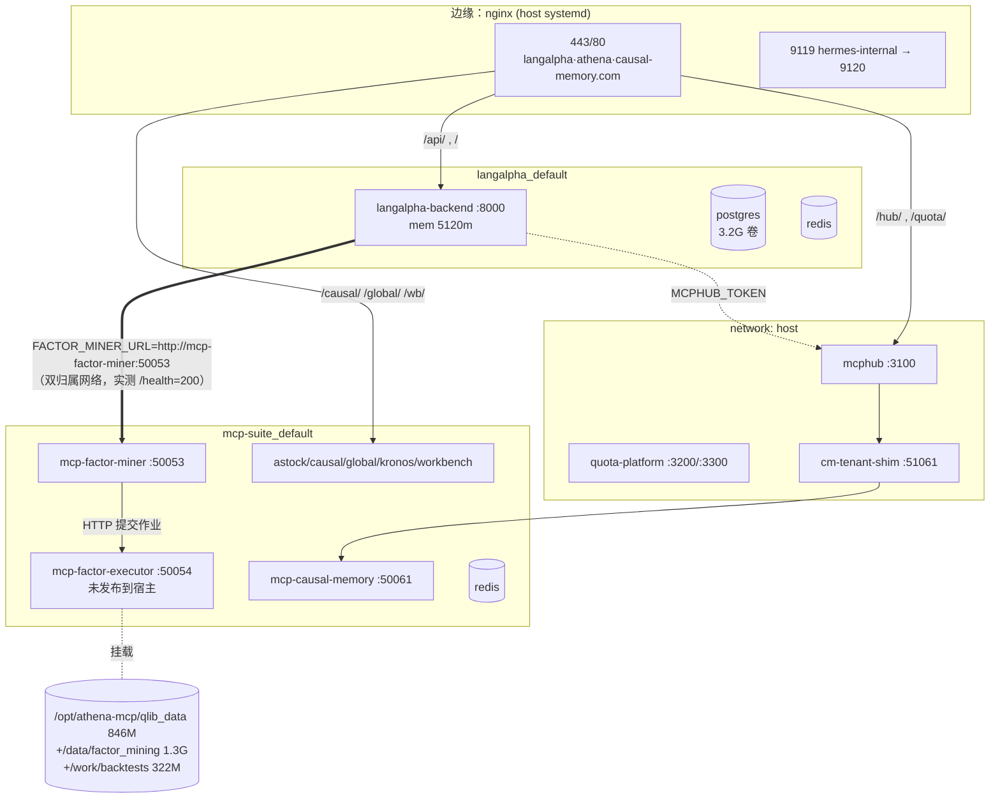
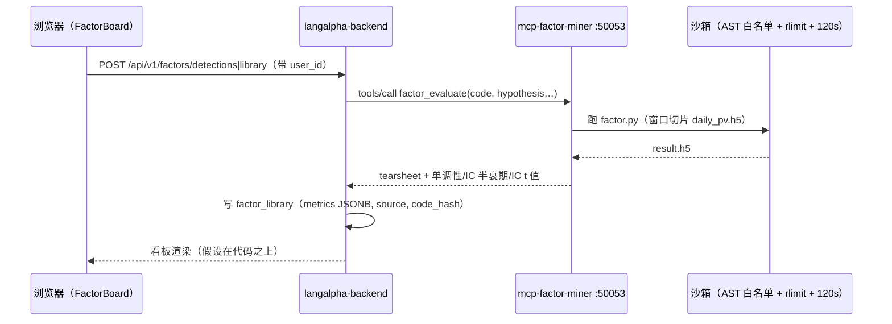
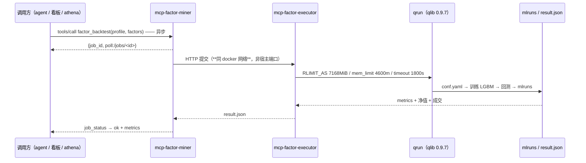
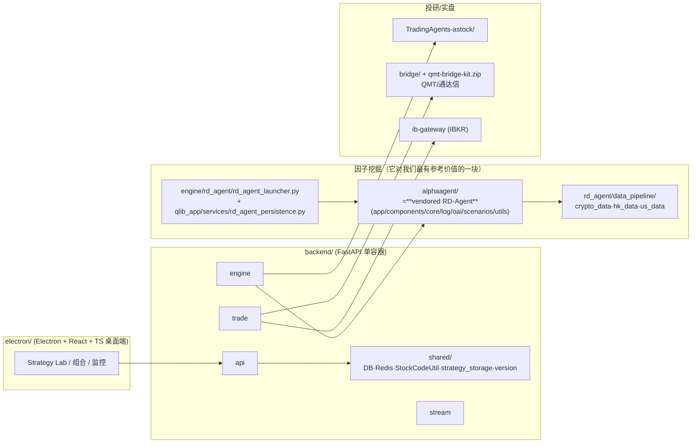

# 系统架构（实测版）

> 全部内容于 **2026-09-23** 在 `root@47.90.253.85` 与本地实测取得（`docker inspect` / `docker ps` /
> 容器内 `env` / nginx 配置 / 跨网络探活），不是凭记忆画的。凡推断处标「推断」。
> 配套：`rdagent-qlib-integration.md`（RD-Agent×Qlib 集成）、`factor-board.md`（因子看板）、
> `platform-contract.md`（turn 的接入面）

---

## 0. 一页全景

```
                         ┌─────────────── 公网 ───────────────┐
                         │  langalpha.causal-memory.com        │
                         │  athena.causal-memory.com           │
                         │  causal-memory.com                  │
                         └──────────────┬──────────────────────┘
                                        │  nginx (host, systemd)
     ┌──────────────────────────────────┼───────────────────────────────────────┐
     │ :8000 LangAlpha backend          │ :3200 hub 数据面 / :3300 quota 管理面   │
     │ :50057 /causal/  :50058 /global/ :50062 /wb/ (mcp·tools 已 403)            │
     └──────────────────────────────────┴───────────────────────────────────────┘
                                        │
        ╔═══════════════════════════════▼═══════════════════════════════╗
        ║  平台层  project=langalpha      network: langalpha_default     ║
        ║  backend(FastAPI, 5120m, :8000) + postgres(3.2G) + redis      ║
        ║  SANDBOX_PROVIDER=daytona   SUPABASE_URL=远端 auth            ║
        ╚═══════════════════════════════╤═══════════════════════════════╝
                                        │ backend 双归属网络（实测）
        ╔═══════════════════════════════▼═══════════════════════════════╗
        ║  MCP 域层  project=mcp-suite   network: mcp-suite_default      ║
        ║  factor-miner :50053 ──HTTP──▶ factor-executor :50054(不发布) ║
        ║  astock-data :50052  causal :50057  global-data :50058        ║
        ║  kronos :50059  workbench :50062  causal-memory :50061        ║
        ╚═══════════════════════════════╤═══════════════════════════════╝
                                        │
        ╔═══════════════════════════════▼═══════════════════════════════╗
        ║  控制面 (network: host)   mcphub :3100                        ║
        ║  宿主机 systemd          cm-tenant-shim :51061                 ║
        ╚═══════════════════════════════╤═══════════════════════════════╝
                                        │
   ┌────────────────────────────────────▼────────────────────────────────────┐
   │ 数据层                                                                   │
   │  /opt/athena-mcp/qlib_data      846M   qlib .bin（6152 标的）            │
   │  /opt/athena-mcp/data/factor_mining 1.3G  daily_pv_{all,debug}.h5+缓存   │
   │  /opt/mcp-suite/backtests       322M   每次回测的 workspace/产物         │
   │  langalpha-postgresql-data      3.2G   LangAlpha 业务库（含因子库）      │
   │  ~/project/athena/athena.db     400M   athena 引擎库（本地）             │
   └─────────────────────────────────────────────────────────────────────────┘
```

---

## 1. 容器清单（14 个，实测）

| 容器 | compose 项目 | 端口（宿主） | mem_limit | 网络 | 角色 |
|---|---|---|---|---|---|
| `langalpha-backend-1` | langalpha | 8000 | **5120m** | langalpha_default **+ mcp-suite_default** | 平台 API（FastAPI） |
| `langalpha-postgres-1` | langalpha | 5432 | 1024m | langalpha_default | 业务库（因子库/对话/用户） |
| `langalpha-redis-1` | langalpha | 6379 | 768m | langalpha_default | 平台缓存 |
| `mcp-factor-miner` | mcp-suite | 50053 | 1536m | mcp-suite_default | 因子挖掘 MCP（18 工具） |
| `mcp-factor-executor` | mcp-suite | **未发布** | **4600m** | mcp-suite_default | qrun 执行器（RLIMIT 7168） |
| `mcp-astock-data` | mcp-suite | 50052 | 384m | mcp-suite_default | A 股数据域 |
| `mcp-causal` | mcp-suite | 50057 | 512m | mcp-suite_default | 因果链域 |
| `mcp-global-data` | mcp-suite | 50058 | 512m | mcp-suite_default | 海外数据域 |
| `mcp-kronos` | mcp-suite | 50059 | 1536m | mcp-suite_default | 时序模型域 |
| `mcp-causal-memory` | mcp-suite | 50061 | 384m | mcp-suite_default | 记忆库（多租户） |
| `mcp-workbench` | mcp-suite | 50062 | 768m | mcp-suite_default | 工作台 |
| `redis` | mcp-suite | 6379（内部） | 384m | mcp-suite_default | 域侧 Redis |
| `mcphub` | — | **3100**（host） | 768m | **host** | MCP 网关/聚合（10 server） |
| `quota-platform` | — | 3200/3300（host） | 384m | **host** | 配额数据面 + 管理面 |
| `cm-tenant-shim` | systemd（非容器） | 51061 | — | host | causal-memory 租户透传修正 |

**MCPHub 已注册的 server（10 个，实测 `/opt/mcp-hub/mcp_settings.json`）**：
`astock-data :50052`、`factor-miner :50053`、`causal :50057`、`global-data :50058`、`kronos :50059`、
`causal-memory :51061`（走 shim）、`workbench :50062` + stdio 三个（`fetch`/`time`/`sequential-thinking`）。

### 1.1 athena 引擎的部署实况（实测，重要）

| 组件 | 位置 | 状态 |
|---|---|---|
| athena **引擎**（Go，REST `:18765`） | — | **未运行**（本机无监听、无进程；服务器上也没有容器/进程） |
| athena **MCP server** | 本机 `~/Documents/deepseek/athena-plugin/bin/athena-mcp-server`（PID 1676） | **在跑** —— 我这一侧 `get_briefing`/`get_signals`/… 都是它在服务 |
| athena 库 | `~/project/athena/athena.db`（400M，约 10 张业务表） | 可读；**挖矿三表 0 行** |

→ 结论：**「大脑」目前是"数据库 + MCP 读面"在场，"引擎/循环"不在场。**
这解释了为什么 `run_factor_mining` 类工具从没产出过 —— 它依赖的引擎没起。
（也因此，本文把 athena 定位为「数据与读面已就位、写面未启用」，而不是"已上线的大脑"。）

---

## 2. 网络拓扑（实测）



**三个网络归属要点**（实测）：
1. `langalpha_default` = backend + postgres + redis；
2. `mcp-suite_default` = 10 个域容器 + **`langalpha-backend-1`（双归属）** —— 跨域调用靠这一条，而不是靠宿主端口；
3. `mcphub` 与 `quota-platform` 在 **host** 网络（所以它们能用 `127.0.0.1:5005x` 直连域容器，也解释了为什么安全组封掉 3200/3300 后仍从 `causal-memory.com/hub/` 可达）。

---

## 3. 数据资产与所有权

| 资产 | 位置 / 大小 | 谁写 | 谁读 | 备注 |
|---|---|---|---|---|
| qlib 二进制行情 | `/opt/athena-mcp/qlib_data` **846M** | `update_data`（三源熔断） | executor 内 `qrun` | 6152 标的、`csi300.txt` 在；**日历不可回填** |
| 因子面板 h5 | `/opt/athena-mcp/data/factor_mining`（含 `daily_pv_{all,debug}.h5`）**1.3G** | `gen_data` / `update_data` | 沙箱内 factor.py、`factor_recent_ic` | 契约：`pd.read_hdf('daily_pv.h5', key='data')` |
| 回测 workspace | `/opt/mcp-suite/backtests` **322M** | executor | miner 解析 | `<hash>/{conf.yaml,result.json,mlruns,factors/<name>/result.h5}`；有 TTL 清理 |
| 平台业务库 | `langalpha-postgresql-data` **3.2G** | LangAlpha backend | backend | 含 `factor_library`（migration 044）、对话、用户 |
| 引擎库 | `~/project/athena/athena.db` **400M**（本地） | athena 引擎 | athena MCP 工具 | **`mining_runs`/`mining_events`/`factor_library` 目前 0 行** |
| 认证 | Supabase（远端） | — | backend（platform 模式） | `VITE_SUPABASE_*` + backend `SUPABASE_URL` |
| 凭据/密钥 | `/opt/athena-mcp/licenses/licenses.json`、`/opt/mcp-suite/.env`、`/opt/mcp-hub/mcp_settings.json` | 运维 | 各域服务 | miner 要 `X-License-Key`；hub 用 `MCPHUB_TOKEN` |

---

## 4. 链路 A：因子看板的一次「评估」（轻，走沙箱，**已验证可用**）



## 5. 链路 B：`qrun` 全量回测（重，**2026-09-23 首次实测跑通**）



**实测数字**：smoke（30 票×2019）**42.1s**；full（csi300×2008→今）**218.1s**，
`IC 0.01906 / RankIC 0.01565 / ICIR 0.14784 / 年化含费 +4.40% / MDD -19.69%`，净值 2342 点、成交 5000 笔。
（对应 §7 的内存约束：`RLIMIT_AS` 必须 >5120MiB。）

## 6. 链路 C：MCP 域与多租户鉴权

- **两条鉴权链**：① 域服务用 `MCP_LICENSE_FILE`（`X-License-Key`）——miner 实测无 key 直接 `-32001`；
  ② hub 侧用 `MCPHUB_TOKEN` + `vault:` 注入（host 限定 `causal-memory.com`）。
- **causal-memory 是唯一"多租户"域**：`mcphub` → `cm-tenant-shim :51061`（systemd，修 passthrough header）→
  `mcp-causal-memory :50061`；14 个租户 token，用户 key = `贺璟轩-h8jsdx`。
- **反代白名单**：`/wb/mcp`、`/wb/tools` 显式 `return 403`（只放 `/wb/ui` 与 `/wb/api/report`）——域级 MCP 不直接对公网暴露，只经 hub。

---

## 7. 资源预算与脆弱点

**内存总账（实测 mem_limit 之和）**：

| | 值 |
|---|---|
| 14 个容器 mem_limit 合计 | **18,680 MB** |
| 物理内存 | **7,456 MB** |
| 超卖倍数 | **2.5×**（executor 曾为 8192m 时是 3.0×） |
| 当前占用 | used 3,559 / avail 3,897 MB |
| 磁盘 | 49G/69G（**75%**，17G 余量） |

**Top 内存**：`langalpha-backend-1 5120m` > `mcp-factor-executor 4600m` > `mcp-factor-miner 1536m` = `mcp-kronos 1536m`。

**已知脆弱点（都是实测过的）**：

| # | 问题 | 证据 | 状态 |
|---|---|---|---|
| 7.1 | **执行器内存上限曾被我砍到必挂** | `RLIMIT 2300` → full profile `MemoryError`(62s)；README 实测需 >5120MiB | ✅ 已修（4600m / 7168） |
| 7.2 | **重任务单槽位缺看门狗** | `update_data` 超时后 `handler thread left running (not killable)` → 槽位永久占用，后续提交被拒 | ❌ 未修 |
| 7.3 | **重任务闸门易误读** | `-32029` 是 **per-license-key 串行单槽**（`mcp_gateway.py:367`）；拿不到 `job_id` 时作业可能其实已在跑，需核对 `/metrics` 台账 | ⚠️ 需文档化 + 调用方兜底 |
| 7.4 | **`update_data` 日更是断的** | 东财 502 / `mootdx` 需 bestip / 覆盖率 155-5204 / 4×3600s 超时 | ❌ 未修 |
| 7.5 | **静默冻结史** | 4 次（load 30 / avail 493M / python 2245M + qrun 1479M），无 OOM 无 panic | 缓解（限内存） |
| 7.6 | **athena 挖矿大脑从未跑过** | 引擎未运行（无进程/无监听）；`mining_runs`/`mining_events`/`factor_library` = 0 行 | ❌ 未启用（只有 MCP 读面在跑） |

---

## 8. 对照：QuantMind 的架构（从仓库拉出来的）

> 1528★ / AGPL-3.0 / 创建 2026-04-15 / pushed 2026-09-22 / 贡献者 3 人（`qusong0627`、**`cursoragent`**、`guge199205-byte`）

### 8.1 后端：单入口 4 服务（`backend/main_oss.py` + `SERVICE_MODE`）

| 服务 | 端口 | 职责 |
|---|---|---|
| `api` | 8000 | 用户认证、策略管理、社区 |
| `engine` | 8001 | **Qlib 回测、AI 策略生成、模型推理** |
| `trade` | 8002 | 订单管理、持仓、风控 |
| `stream` | 8003 | 实时行情、WebSocket 推送 |

### 8.2 容器（`docker-compose.yml`，实测）

```
db(postgres:15)  redis(7)  quantmind(应用)  celery-worker  celery-beat
data-gateway(quantmind-data-gateway)  qwenpaw(agentscope/qwenpaw)  ib-gateway(IB 券商网关)
huntly(书签)  rsshub(信息流)      —— 网络 quantmind-net
```

### 8.3 关键模块分工



- **因子挖掘的接法**：**把 RD-Agent 整个 vendor 成 `alphaagent/`**（5142 个文件里 **947 个** rdagent 相关，
  `app/components/core/log/oai/scenarios/utils` 与上游一致），再由 `rd_agent_launcher.py` 编程式拉起、
  `rd_agent_persistence.py` 持久化结果，并按市场补 `data_pipeline/*`。
  → **社区对「怎么把 RD-Agent 接进自己平台」最成熟的答案 = vendor + launcher + persistence。**
- **数据**：48 维特征由外部服务写入 PG `market_data_daily`；Redis 分工 0=通用 1=认证 2=交易 3=行情 4=回测 5=缓存；
  Celery 队列 `qlib_backtest_srv` 跑回测。
- **分发**：Gitea `master` 为真相源，`release-index.json` + `backend/shared/version.py` 做「落后几个提交」提示。
- **工程规矩（值得抄的）**：
  1. **Celery worker 必须唯一**（重复 worker 瓜分队列 → 定时任务随机不执行，排查靠 `redis-cli client list | grep cmd=brpop` 只有 1 个）；
  2. **股票代码分层转换**：数据层后缀式 `600036.SH` / qlib `sh600036`，PG·Redis·前端前缀式 `SH600036`，
     边界必须走 `StockCodeUtil`，禁止手写切片（**与我们的 `sh600036` 口径问题同源**）；
  3. 瞬时时间列一律 `TIMESTAMPTZ` + aware UTC（naive 与墙钟混用会让 asyncpg 整笔回滚）。

### 8.4 与我们对照

| 维度 | 我们（LangAlpha + mcp-suite + athena） | QuantMind |
|---|---|---|
| 形态 | 平台底座 + 研究闭环，MCP 域化、可插拔 | 端到端产品（含桌面端 + 实盘） |
| 因子挖掘 | 自建执行层（miner + qrun 执行器），**不搬 RD-Agent 代码** | **vendor RD-Agent 成 `alphaagent/`** |
| 模型 | 因子库 + 看板 + 准入（candidate/promoted/rejected） | 13 种模型工场 + 50 个策略模板 |
| 实盘 | 纸面（trader-01 + 三层风控） | **QMT/通达信 + IBKR** |
| 市场 | A 股为主（+ global-data 域） | A股/港股/美股/期货/加密 |
| 许可 | 自有 | **AGPL-3.0（传染）** |
| 团队 | 你 + 多个 agent 会话 | 1 人 + AI agent |

**可借鉴**：`alphaagent` 的改造手法、`launcher + persistence` 的分层（对应我们 P2 的 run 台账）、
多市场 `data_pipeline` 结构、以及 §8.3 那三条工程规矩。
**不可借鉴**：**代码本身**（AGPL-3.0 会传染到 LangAlpha 这种对外服务的平台）；以及不要用它替换我们的分层 ——
它是产品，我们的价值在域化 MCP + 权限/配额/记忆这些底座能力。

---

## 9. 待办（按优先级）

1. **修 7.2/7.3**：重任务槽位看门狗 + `-32029` 互斥判定（否则「提交不进去」会再犯）。
2. **修 7.4**：`update_data` 日更（面板一停更，回测会静默用旧数据 —— 这是最隐蔽的一类错）。
3. **7.6**：athena 挖矿大脑是否启用（`run_factor_mining` / `get_mining_runs` 已就绪但 0 行）。
4. **P0（半天）**：`FACTOR_SOURCES += "rdagent"` + importer（RD-Agent 产物进因子库）。
5. 监控补强：把 §7 的六个脆弱点做成告警（现在只有一个 crash-sentinel 脚本）。
